## Цели на сегодня ##

* организационные моменты
* формальные модели как абстрактные модели
* что такое синтаксис?
* обзор материала
* синтаксическая структура и порядок слов
* части речи
    - дистрибутивные критерии
    - формальные критерии
* лексические и функциональные категории

# Организационное #

## Лекции и семинары ##

* встречаемся еженедельно;
* **посещаемость чрезвычайно важна для адекватного усвоения материала**


## Работа на занятии ##

* задавайте свои вопросы по ходу изложения материала, не откладывайте на потом
* не стесняйтесь отвечать на мои вопросы
* к занятиям необходимо готовиться
    * чтение заданных глав и страниц **перед** занятием
    * выполнение заданных упражнений


## Литература ##

* Митренина О.В., Романова Е.Е., Слюсарь Н.А. 2012. *Введение в генеративную грамматику*. — М.: Книжный дом «ЛИБРОКОМ».

## Критерии оценки знаний, навыков  ##

* Своевременное выполнение самостоятельных работ, внятное изложение решений.
* Знакомство с основными языковыми явлениями и понятиями, обсуждавшимися на занятиях, владение основными методами анализа.
* Знакомство с содержанием статей, заданных для самостоятельного прочтения.

Оценки по всем формам текущего контроля выставляются по 10-ти балльной шкале

## Порядок формирования оценок по дисциплине  ##

<!--
- контрольная работа №1: 30\%
- контрольная работа №2: 30\%
- письменный экзамен: 40\%
-->	

- домашнее задание: 25%
- викторина: 35%
- письменный экзамен: 40%

# Наука о языке #
	
## Лингвистика и формальные модели ##

* Язык является **удивительным проявлением человеческого сознания**.
* Язык --- не просто **средство коммуникации**, но и **инструмент мысли**.
* Лингвистика --- часть когнитивной науки, чьей целью является **поиск ментальных абстрактных структур и алгоритмов, вовлечённых в мышление, понимание и использование языка**.
    * Каким образом последовательность звуков способна инициировать последовательность мыслей?
    * Вероятно, в сознании человека существуют определённые символические структуры.

## Научный метод ##

* Наука --- поиск знания и **понимания** того, как устроен мир.
* Достичь понимания значит открыть **общие законы и принципы**.
* Научные принципы и законы **подвергаются экспериментальной проверке**.

## Какое отношение это имеет к грамматике? ##

* Что значит *понимать* грамматику?
* Какие могут существовать *законы и принципы* грамматики?
* Каким образом можно *проверить* эти законы и принципы грамматики *экспериментально*?

## Язык как объект естественного мира ##

* Языковая способность не является **артефактом**, а появилась в процессе **эволюции**
* Язык не учат, а **усваивают**

## Знание языка ##

Когда мы слышим высказывания типа „Я знаю *x*”, то у нас обычно возникают следующие **вопросы**:

* Что именно он(а) знает?
* Как он(а) получил(а) это знание?
* Как это знание используется?

## Формальные модели как модели знания ##

Если эти же вопросы применить к языку, то получится примерно следующее:

* Что именно человек знает, зная язык?
* Как происходит усвоение языка?
* Как знание языка используется (например, в речи или понимании)?

С такой точки зрения формальные модели --- это **модели знания**, полученного нами в процессе усвоения языка.

## Ещё о формальных моделях ##

Этот курс посвящён **генеративной** лингвистике.

Основная её цель заключается в попытке объяснить и понять языковые явления путём создания **теории** глубинных механизмов, лежащих в основе этих явлений.
  
* в этом смысле химия/биология/физика точно так же генеративны

Генеративная лингвистика руководствуется соображениями простоты при сравнении конкурирующих теорий.


## Ещё о знании языка ##

Знание языка обусловлено **языковой способностью**

* Языковая способность присуща только человеку
* Языковая способность является врождённой
    * как это показать?
* Языковая способность лишь косвенно связана с коммуникацией
* Языковая способность не сводима к общим когнитивным механизмам

В противном случае перед нами логическая проблема

## Языковая способность присуща только человеку ##

  * тривиально истинно, но можем обсудить
      * необходимо сравнить с другими животными
      * необходимо сравнить с машинами

## Язык $≠$ коммуникация ##

Часто говорят, что главной функцией языка является функция **коммуникативная**.

Значит ли это, что язык является прежде всего системой коммуникации?

Давайте сравним **язык** и **алкоголь** [@Adger:2019].

## Язык и коммуникация ##

Несомненно, что коммуникация — одно из применений языка, но это ничего не говорит нам о том, что же такое язык (или языковая способность).

У алкоголя множество разных применений (рекреационные, медицинские, технологические и пр.). 

* никакое из этих применений не говорит нам, что же такое алкоголь
* только химик по-настоящему знает, что это: CH~3~CH~2~OH

Как только мы узнали химическую структуру алкоголя, мы можем понять, почему алкоголь применяется таким образом, каким он применяется.

## Язык и коммуникация ##

Так же и язык: мы поймём, почему языковая способность используется в тех целях, в которых она используется, не ранее, чем мы поймём, как она устроена.

*  сначала нужно выявить **абстрактные структуры** языковых выражений (подобно атомам углерода, водорода и кислорода в составе молекулы этанола)

## Усвоение языка как логическая проблема: [*modus ponens*]{lang=en-GB} ##

(*modus ponens* — доказательство способом вывода (т.е. силлогизм))

### Посылка 1 ###

* Синтаксис — это продуктивная, рекурсивная и бесконечная система

### Посылка 2 ###

* Бесконечные системы правил нельзя выучить

### Вывод ###

* Синтаксис невозможно выучить; следовательно, наличие у нас синтаксиса означает, что он частично врождённый

## Посылка 1 ##


### Язык — продуктивная система ###

* любой носитель любого языка способен порождать и понимать предложения, которых никогда прежде не слышал


::: {.fragment}

### Задание ###

* Придумайте предложение длиной примерно в строку-полторы
* „Вбейте“ его --- в кавычках --- в поисковую строку Гугла
* Что получается?

:::

## Посылка 1 ##

### Языковая система рекурсивна ###

* предложения могут включать в себя предложения
    - Студенты читают книгу. 
    - Я думаю, что студенты читают книгу. 
    - Ты сомневаешься, что я думаю, что студенты читают книгу
    - …

## Посылка 1 ##

### Языковая система бесконечна ###

* существует ли самое длинное предложение?
* существует ли самое большое число?

::: {.fragment}

* нет!

:::

## Посылка 2 ##

### Бесконечные системы невозможно выучить ###

* ребёнок должен, основываясь на конечном массиве данных, перейти к бесконечной системе
    - например, суметь установить соответствие между предложением и ситуацией, которую оно описывает
* давайте рассмотрим аналогичную ситуацию в математике

## Посылка 2 ##

| Предложение (ввод) | Ситуация (вывод) |
|--------------------|------------------|
| *x*                | *y*              |
| 1                  | 1                |
| 2                  | 2                |
| 3                  | 3                |
| 4                  | 4                |
| 5                  | 5                |
| 6                  | ?                |

**Задача:** на основании имеющихся данных охарактеризовать функцию, ставящую *x* в соответствие *y*.

## Посылка 2 ##

Очевидный ответ: *x* = *y* 

* Следовательно, *y* = 6 

. . . 

Менее очевидный ответ: [(*x* - 5) × (*x* - 4) × (*x* - 3) × (*x* - 2) × (*x* - 1)] + *x* = *y*

* Следовательно, *y* = 126

. . . 

Для того, чтобы выучить правило, необходимо знать **весь** input, т.е. располагать **всеми** данными.

* Но мы только что выяснили, что это невозможно, т.к. число предложений бесконечно.

## Усвоение языка как логическая проблема: *modus ponens* ##

(*modus ponens* — доказательство способом вывода (т.е. силлогизм))

### Посылка 1 ###

* Синтаксис — это продуктивная, рекурсивная и бесконечная система

### Посылка 2 ###

* Бесконечные системы правил нельзя выучить

### Вывод ###

* Синтаксис невозможно выучить; следовательно, наличие у нас синтаксиса означает, что он частично врождённый 

# Синтаксис #

## Что такое синтаксис? ##

Синтаксис --- это «мостик» между *звуком* и *значением*

* семантика --- **синтаксис** --- фонология и фонетика

## Синтаксис как научная дисциплина ##

### Устройство предложения ###

* слова, словосочетания, предложения и *иерархическая* структура
* грамматические признаки 
* синтаксические процессы и порядок слов

### Структура и иерархия ###

* структура
    - части целого
* иерархия
    - упорядоченность частей по отношению друг к другу
	
## Предмет и задача синтаксиса

Синтаксис изучает **правила** комбинации слов (неформальное определение)

- *Ключевой факт*: Носители воспринимают некоторые цепочки слов как **допустимыe**, а некоторые как **недопустимые**.
    - The clever snake disappeared into a hole in the ground.
    - \*Hole into disappeared ground the the in clever a snake.

**NB:** помета **\*** перед языковым выражением означает его неприемлемость.

# Сократическая беседа #

## Необходимость синтаксиса ##

**Q**: Зачем изучать правила синтаксиса? Ведь любой носитель языка их и так знает!

**A**: Носитель „знает” их **имплицитно**, но не может их сформулировать, а, скорее, обладает ими подобно визуальной системе [@Ludlow:2011]. Правила шахмат или искуственных языков имеют иную природу.


## Необходимость синтаксиса ##

**Q**: А нужны ли особые правила? Возможно, человек просто запомнил приемлемую цепочку.

**A**: Количество допустимых предложений слишком велико (потенциально **бесконечно**). Кроме того, люди способны оценить предложения, которые они никогда не слышали.


## Необходимость синтаксиса ##

**Q**: Носитель считает приемлемые предложения допустимыми, т.к. понимает их смысл.

**A**: Носитель способен оценивать как допустимые даже **семантически аномальные** предложений и наоборот.


* Глокая куздра штеко будланула бокра и курдячит бокрёнка.
* \*Моя твоя не понимай.
* Colourless green ideas sleep furiously.
* \*The child seems sleeping.
* Если не шаришь, то стопроц возьмёшь паль на свопе.


## Необходимость синтаксиса ##

**Q**: А что если носитель ошибается в своей оценке? Например, при **grammaticality illusions**
    * More people have been to Russia than I have.

**A**: Визуальная система тоже может „ошибаться“, но это не значит, что её не надо изучать.

::: {style="text-align: center;"}
{ width=30% }
:::

## Чем синтаксис не является? ##

* изучение того, как *лучше* говорить
* *-тся/-ться* и прочие «грамматические» ошибки

Таким образом, формальный синтаксис **не является прескриптивным**

## Что значит „прескриптивный“? ##

* изучение и преподавание иностранного языка
* правила орфографии и пунктуации
* рекомендации по улучшению коммуникативного стиля
* социальное профилирование

## Формальное представление --- аналитический инструмент ##

* научный взгляд на языковые явления
    - наблюдение
    - поиск обобщений и объяснений
    - межъязыковая релевантность
* изучает грамматику как систему

## Структура ##

Синтаксис оперирует **иерархическими структурами**. Следовательно, выражения естественного языка должны быть

* разложимы на выделимые части целого, которые
* некоторым образом упорядочены по отношению друг к другу
    * ср. разбор по членам предложения из школьного курса русского языка
        * который представляет собой разновидность [грамматики зависимостей]{.smallcaps}

## Слова < словосочетания < предложения ###

::: incremental
  * [Иван]{.c1} [купил]{.c2} [машину]{.c3}
  * [[Тот человек]]{.c1} [купил]{.c2} [[новую машину]]{.c3}
  * [Иван]{.c1} [сказал,]{.c2} [[что он уходит]]{.c3}
  * [[Тот человек, [который купил новую машину]],]{.c1} [сказал,]{.c2} [[что он уходит].]{.c3}
:::

## Структура определяет значение ##

Что значит следующее предложение?

::: lang=en-GB
> John hit the dog with a hat in the garden.
:::

Попробуем выделить несколько отличающихся друг от друга ситуаций, каждую из которых оно могло бы описывать.

## Структура определяет значение ##

::: panel-tabset
### Значение 1

John hit the dog with a hat in the garden.

* Существует собака, которую бьют.
* Шляпа выступает в качестве инструмента.
* Сад выступает в качестве места события.

### Значение 2

John hit the dog with a hat in the garden.

* Существует собака со шляпой на голове.
* Эту собаку бьют в саду.
* Нет информации об инструменте.


### Значение 3

John hit the dog with a hat in the garden.

*  Собака, которую бьют, носит шляпу и живёт в саду.
*  Нет информации ни об инструменте, ни о месте действия.


### Значение 4

John hit the dog with a hat in the garden.

* Собаку бьют лежащей в саду шляпой.
* Нет информации о месте действия.

### Значение 5

John hit the dog with a hat in the garden.

* Бьют собаку с „садовой“ шляпой на голове.
* Нет информации ни об инструменте, ни о месте действия.

### Значение 6

John hit the dog with a hat in the garden.

* \*Джон ударил находящуюся/живущую в саду собаку при помощи шляпы.

[]{.caution-sign} Такого значения рассматриваемое предложение не имеет.
:::

## Структура определяет значение

Избавимся от инвариантной части, т.е. от подлежащего *John*, и представим остаток в виде кубиков LEGO.

::: {style="text-align: center;"}
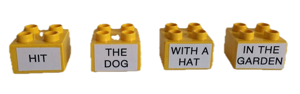{ width=55% }
:::

[]{.caution-sign} Каждый кубик соответствует члену предложения в традиционной грамматике.

## Значение 1

:::: {.columns}

::: {.column width="50%"}
John hit the dog with a hat in the garden.

* Существует собака, которую бьют.
* Шляпа выступает в качестве инструмента.
* Сад выступает в качестве места события.

:::

::: {.column width="50%"}
::: {style="text-align: center;"}
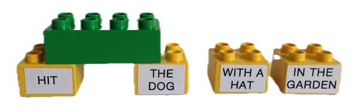{ width=65% } 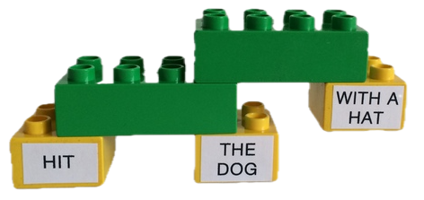{ width=65% } 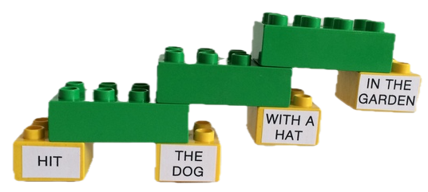{ width=65% }
:::
:::
::::

## Значение 2

::::: {.columns}
:::: {.column width="50%"}
John hit the dog with a hat in the garden.

* Существует собака со шляпой на голове.
* Эту собаку бьют в саду.
* Нет информации об инструменте.
::::

:::: {.column width="50%"}
::: {.r-stack}
::: {.fragment .fade-out fragment-index=2}
::: {style="text-align: center;"}
{ width=60% }
:::
:::


::: {.fragment .fade-in fragment-index=2}
::: {style="text-align: center;"}
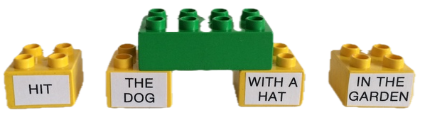{ width=65% } 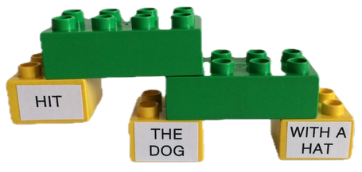{ width=65% } 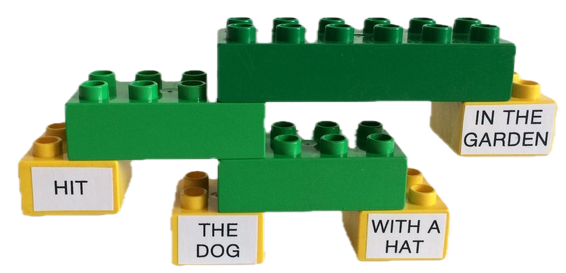{ width=65% }
:::
:::
:::
::::
:::::

## Значение 3

:::: {.columns}

::: {.column width=50%}
John hit the dog with a hat in the garden.

*  Собака, которую бьют, носит шляпу и живёт в саду.
*  Нет информации ни об инструменте, ни о месте действия.

:::

::: {.column width=50%} 
::: {style="text-align: center;"}
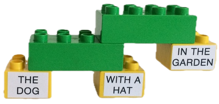{ width=60% } 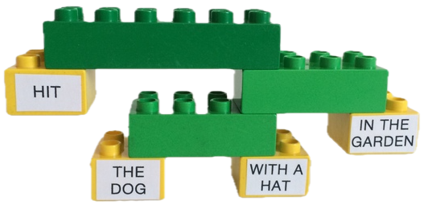{ width=60% } 
:::
:::
::::

## Значение 4

:::: {.columns}
::: {.column width=50%}
John hit the dog with a hat in the garden.

* Собаку бьют лежащей в саду шляпой.
* Нет информации о месте действия.

:::

::: {.column width=50%}
::: {style="text-align: center;"}
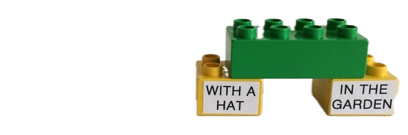{ width=65% } 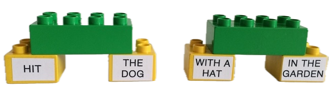{ width=65% } 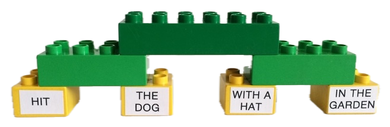{ width=65% }
:::
:::
::::

## Значение 5

:::: {.columns}
::: {.column width=50%}
John hit the dog with a hat in the garden.

* Бьют собаку с „садовой“ шляпой на голове.
* Нет информации ни об инструменте, ни о месте действия.

:::

::: {.column width=50%}
::: {style="text-align: center;"}
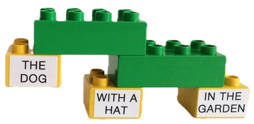{ width=75% } 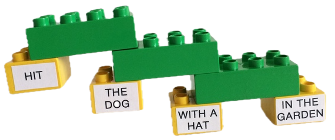{ width=80% }
:::
:::
::::

## Значение 6

:::: {.columns}
::: {.column width=50%}
John hit the dog with a hat in the garden.

* \*Джон ударил находящуюся/живущую в саду собаку при помощи шляпы.
  * должно быть логически возможно

:::

::: {.column width=50%}
::: {style="text-align: center;"}
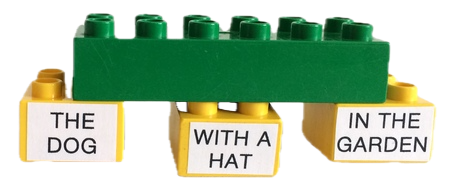{ width=75% } 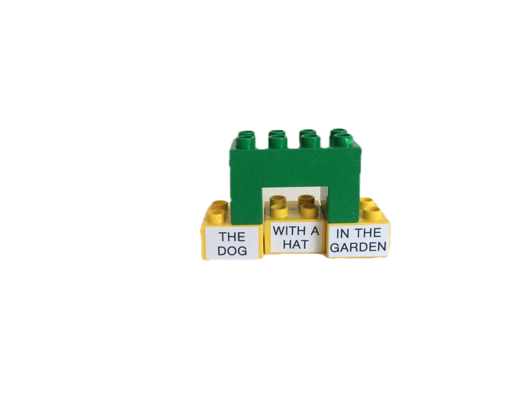{ width=150% }
:::
:::
::::

## Структура определяет значение ##

Мы увидели, что одна и та же цепочка слов может иметь несколько значений ввиду разницы в иерархической структуре.
  
  * ср. с **изомерами** в химии (напр., глюкозой и маннозой)
  
::: {style="text-align: center;"}
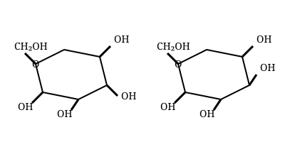
:::

## Нотация для синтаксических структур ##

Итак, мы увидели, что структура предложения сложнее одноуровнего соположения входящих в него слов:


::: {.r-stack}
::: {.fragment .fade-out fragment-index=1}
::: {style="text-align: center;"}
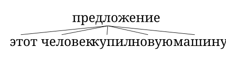
:::
:::
::: {.fragment .fade-in fragment-index=1}
::: {style="text-align: center;"}
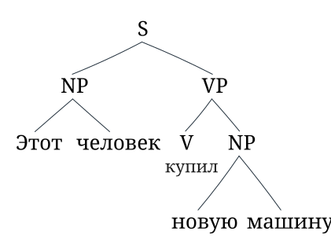
:::
:::
:::

## Язык и коммуникация {.incremental}

#### Коммуникация~1~ ####

* процесс передачи информации от одного человека к другому по разным каналам связи посредством общей системы знаков.
    * обмен информацией между двумя и более речевыми субъектами,
    * наличие общей системы знаков

#### Коммуникация~2~ ####

  * эффективное синхронное и диахронное взаимодействие, цель которого состоит в передаче информации от одного субъекта к другому


#### Коммуникация~3~ ####

  * обмен информацией между живыми организмами (общение)

## Язык и коммуникация: эффективность ##

### Эффективность = однозначность ###

  * эффективная передача сообщения/информации исключает любую неоднозначность
      * естественный же язык изобилует неоднозначностями
          * [полисемия]{.smallcaps} — лексическая неоднозначность
          * [омонимия]{.smallcaps} — лексическая неоднозначность
          * синтаксическая неоднозначность
      * все эти виды неоднозначности возможно сочетать друг с другом

$\rightarrow$ язык — крайне **неэффективная** система коммуникации

## Коммуникация в животном мире ##

Основное свойство коммуникативных систем других животных — [референциальность]{.smallcaps}

. . . 

(реакция на некий стимул в реальном мире — опасность, добыча и пр.)

  * танец пчёл
  * сигналы тревоги мартышек-верветок (vervet monkey alarm calls)
  * …

Коммуникация возможна в отсутствии человеческого языка.

# Единицы синтаксиса #

Описанию структуры предложения всегда сопутствует поиск грамматических закономерностей: для того, чтобы установить отношения между частями целого, необходимо эти части **выделить** и **категоризовать**.

Каждый носитель того или иного языка способен отличить последовательность звуков, являющихся приемлемым предложением на этом языке, от цепочки звуков, таковыми не являющихся.

## Части речи ##

Части речи --- это попытка найти закономерности в языковых выражениях.

* традиционные «школьные» определения ненадёжны и циркулярны
* необходимо использовать **формальные** (морфологические, парадигматические) и **дистрибутивные** (синтаксические, синтагматические) критерии
    * такие критерии носят *дедуктивный* характер

## Формальные критерии ##

Выделение классов слов на основе их **формы**. Несколько примеров:

* **глаголы:** постфикс *-ся*
* **существительные:** уменьшительно-ласкательные суффиксы 
* **прилагательные:** полная и краткая формы

## Дистрибутивные критерии ##

Выделение классов слов на основе их **позиции**. Несколько примеров:

* **глаголы:** употребляются с модальными предикатами 
* **существительные:** следуют за детерминаторами
* **прилагательные:** аттрибутивно-предикативное чередование

## Лексические и функциональные категории ##

**Лексические категории** обладают достаточно очевидным описательным содержанием

  * существительные -- *стол, куртка, одиночество, азарт*
  * прилагательные -- *незаметный, жёлтый, пряный*
  * глаголы -- *посещать, бежать, веселиться*
  
**Функциональные категории** обладают исключительно грамматическим значением

  * определители/артикли -- *the, each*
  * предлоги (?) -- *над, под, в, из-за*
  * союзы -- *что, чтобы*
  

## Морфемы, лексемы, слова ##

#### Морфема ####

* минимальная единица, несущая значение

#### Лексема ####

* минимальная *самостоятельная* единица, несущая значение

#### Аффикс ####

* морфема, не являющаяся независимой

#### Слово ####

* самостоятельная единица, несущая значение

## Несколько примеров ##

* дверь
* языкознание

### Морфема, лексема или слово? ###

* *дверь* = морфема, лексема **и** слово
	- эти понятия не исключают друг друга
* *языкознание* = сложное **слово**
	- *язык-* = **лексема**
	- *зна-* и *-ние* = **морфемы**

## Признаки и их значения ##

* грамматический признак (англ. *feature*) $\rightarrow$ значение (англ. *value*)

| **признак** | **значение**                       |
|-------------+-----------------------------------|
| [время]     | [pst, prs, fut, \dots]{.smallcaps}|
| [число]     | [sg, pl, \dots]{.smallcaps}       |
| [лицо]	  | 1, 2, 3                           |


## Группы ##

Мы уже заметили следующее:

* слова объединяются в группы
* эти группы примерно соответствуют словосочетаниям
* не просто цепочка слов
* один элемент в группе «главнее» остальных\
$\rightarrow$ **вершина**\
$\rightarrow$ у групп есть **внутренняя структура**

Нам ещё предстоит научиться

* определять границы групп
* определять вершины групп

# Группы в предложениях #

## Ищем границы групп ##

Как понять, что отдельно взятая цепочка слов в предложении — группа?

* тесты на **структуру составляющих**

Как принято представлять структуру групп/составляющих?

* скобочная запись; синтаксические «деревья»

## Определяем группы: структура составляющих ##

* Как понять, что перед нами составляющая?
    * **если мы видим, что эта цепочка ведёт себя как целое**
* Доступные тесты:
    * изолирование
    * замена
    * перемещение
    * замена + перемещение
    * сочинение
* Позитивный результат? $\rightarrow$ вероятно, перед нами составляющая
* Негативный результат? $\rightarrow$ применяем другие тесты!

## Определяем группы: изолирование ##

Может ли цепочка слов употребляться сама по себе?

* Студенты купили [ интересные книги по языкознанию ].
    * Что купили студенты?
    * [ Интересные книги по языкознанию ].
	
$\rightarrow$ *интересные книги по языкознанию* = составляющая

## Определяем группы: замена ##

Может ли цепочка слов быть заменена одним словом?

* Студенты купили [ интересные книги по языкознанию ].
    * Студенты купили **их**.

$\rightarrow$ *интересные книги по языкознанию* = составляющая

## Определяем группы: замена «невидимкой» (эллипсис) ##

Можно ли цепочку опустить?

* Студенты [ купили [ интересные книги по языкознанию ]] \dots 
    * и преподы тоже.
    * а преподы не купили.

$\rightarrow$ *купили интересные книги по языкознанию* = составляющая

$\rightarrow$ *интересные книги по языкознанию* = составляющая

## Определяем группы: перемещение ##

Можно ли поставить цепочку слов в другую позицию?

* Студенты купили [ интересные книги по языкознанию ].
    *  [ Интересные книги по языкознанию ] купили студенты.\
	(двигаем исключительно на левый край)

$\rightarrow$ *интересные книги по языкознанию* = составляющая

## Определяем группы: замена + перемещение ##

Можно ли заменить цепочку одним словом и переместить его?

* Студенты купили [ интересные книги по языкознанию ].
    * [ Что ] купили студенты?

$\rightarrow$ *интересные книги по языкознанию* = составляющая

## Определяем группы: сочинение ##

Можно ли сочинить цепочку с похожей на неё цепочкой?

* Студенты купили [ интересные книги по языкознанию ] 
    * и [ скучные журналы про знаменитостей ]

$\rightarrow$ *интересные книги по языкознанию* = составляющая

## Примеры отрицательных результатов ##

Покажем, что цепочка слов в скобках не похожа на составляющую

* [ Студенты купили ] интересные книги по языкознанию.

## Изолирование ##

Две возможности:

* либо *студенты купили* имеет дистрибуцию *студентов*,
    * и тогда мы задаём вопрос к *студентам*
* либо *студенты купили* имеет дистрибуцию *купили*
    * и тогда мы задаём вопрос к *купили*
	
Проверим:

- [ Студенты купили ] интересные книги по языкознанию.
- \*Кто интересные книги по языкознанию? -- \*Студенты купили.
- Что сделали интересные книги по языкознанию? -- \*Студенты купили.

Результат применения теста «Изолирование» является отрицательным.

## Замена ##

Две возможности:

* либо *студенты купили* имеет дистрибуцию *студентов*,
    * и тогда мы заменяем *студенты купили* на именную проформу (напр., *они*)
* либо *студенты купили* имеет дистрибуцию *купили*
    * и тогда мы заменяем *студенты купили* на (отсутствующую в русском языке) глагольную проформу (что-нибудь типа *сделали это*)
	
Проверим:

- [ Студенты купили ] интересные книги по языкознанию.
- \*Они интересные книги по языкознанию.
- \*Сделали это интересные книги по языкознанию.

В результате обеих замен получаются предложения, не имеющие никакого отношения к исходному.

---------------

Прочие тесты (за исключением эллипсиса и сочинения) дают схожий результат.

Эллипсис и сочинение дают результаты ложноположительные.

## Определяем группы: резюме ##

* Как понять, что перед нами составляющая?
    * **если мы видим, что эта цепочка ведёт себя как целое**
* Доступные тесты:
    * изолирование
    * замена
    * перемещение
    * замена + перемещение
    * сочинение
* Позитивный результат? $\rightarrow$ вероятно, перед нами составляющая
    * возможны ложноположительные результаты
* Негативный результат? $\rightarrow$ применяем другие тесты!

# Структура групп: пролог #

## Группы ##

Повторим:

* слова объединяются в группы
* эти группы примерно соответствуют словосочетаниям
* не просто цепочка слов
* один элемент в группе «главнее» остальных\
$\rightarrow$ **вершина**\
$\rightarrow$ у групп есть **внутренняя структура**

## Вершины и зависимые ##

### Элементы группы ###

* вершина
* комплемент
* адъюнкт/спецификатор

### Отношения между вершиной и зависимыми ###

* **селекция:** вершина требует наличия комплемента
* **порядок слов:** в зависимости от языка
	- вершина--комплемент
	- комплемент--вершина
	
----------------

Пример:

*эти невероятно интересные книги по лингвистике*

(Мы исходим из того, что это группа, и поэтому не тратим время на доказательство этого.)


## Вершина определяет значение группы ##

В группе *эти невероятно интересные книги по лингвистике* речь идёт о книгах

* проблемные случаи (о них ниже) --- это когда вершиной является функциональная, а не лексическая категория

## Вершина определяет грамматическую категорию группы ##

Если X --- вершина, то группа будет XP

* NP (от англ. Noun Phrase)
* VP (от англ. Verb Phrase)
* AP (от англ. Adjective Phrase)
* PP (от англ. Prepositional Phrase)
* и т.п.

## Вершину нельзя опустить ##

*\*эти невероятно интересные по лингвистике*

**NB:** не то же самое, что эллипсис!

## У вершины та же дистрибуция, что у группы ##

*Я читаю эти невероятно интересные книги по лингвистике*

$\rightarrow$ *Я читаю книги*

## Вершина определяет зависимое ##

* наличие зависимого
* форму зависимого
    * согласование
    * падеж
	
## Значение функциональных категорий ##

**функциональные категории также могут быть вершинами**

* *Миша спросил/сказал* [~CP~ *когда/что его поезд отправляется* ]
    * **значение:** тип предложения (вопрос/утверждение)


## Литература


<!--

# Background

## Last time

The sound side of things:

-   phonetics
    -   articulatory phonetics
    -   acoustic phonetics
    -   auditory phonetics
-   phonology

## Today

The visual side of things:

-   writing and its basic principles
-   writing systems

# Writing

## Definitions

### Writing

A system of recording language by means of visual or tactile marks.

-   why visual?
-   why tactile?

------------------------------------------------------------------------

-   **writing system**
    -   writing system of individual language
    -   abstract type of writing system
-   **script**: graphic form of units within writing system
    -   ‘Over the course of its history, the Turkish language has used the Arabic and the Latin script’

------------------------------------------------------------------------

-   **orthography/spelling**: standardised conventions of particular language-specific writing system
-   **alphabet**:
    -   inventory of basic signs of phonological writing system
    -   inventory of basic signs of *any* writing system in general

## Writing and speech

Writing is always secondary to speech.

-   overwhelmingly many languages have no consistent/standardised way of writing them down
-   no ‘writing-only’ languages with no sound/sign form
-   written form can change without significantly affecting language
-   written form can remain the same but the language itself can change substantially

. . .

In fact, writing is a (legacy) language technology of sorts!

## A few contrasts

Do you agree with the following differences? Feel free to disagree!


|      speech       |     writing      |
|:-----------------:|:----------------:|
|    continuous     |     discrete     |
|    time-bound     |     timeless     |
|   context-bound   |    autonomous    |
|      audible      |     visible      |
| produced by voice | produced by hand |
|                   |                  |


Can you think of more differences?

## What does writing record?

Writing records **utterances**.

-   which are combinations of **meaning** and **sound** expressing that meaning.

Which of these two aspect should be written down?

-   primary focus on meaning?
-   primary focus on sound?

## Writing down sounds

::: incremental
What are the pros?

-   clear instructions as to how a string is to be pronounced

What are the cons?

-   Where do we even start?..
:::

## Writing down sounds: the cons

-   too much variation across languages and within languages for this to be plausible
    -   /pɑ(ː)t/ is the UK pronunciation of *part* and the US pronunciation of *pot*
    -   /ɡɑ(ː)d/ is the UK pronunciation of *guard* and the US pronunciation of *god*
    -   the *t*-like sound in the word *bottle* can in fact be realised in several ways

Punchline: one must not go too far, since the words must ideally be recognisable for outsiders, too.

## Writing down meaning/thoughts/ideas

::: incremental
What are the pros?

-   most of the meanings could be made easily recognisable, thus facilitating learning

What are the cons?

-   Again, …
:::

## Writing down meaning: the cons

-   with the average vocabulary of an average adult speaker of roughly 40,000 words, that would entail learning 40,000 distinct symbols
-   additional signs for writing down grammatically relevant information (present/past/future tense; masculine/feminine/neuter gender *etc.*)

Punchline: one must not go too far, since the inventory of symbols should still be manageable

::: notes
In other words, writing ‘pay this fine or go to jail’ might work when using a concatenation, or sequence, of 7 picture-like symbols (think emoji!), using the same method to record ‘if you had paid this fine, you wouldn't have gone to jail’ is already much trickier.
:::

## Writing down words

So-called **logographic** writing systems

-   Egyptian hieroglyphs
-   Chinese/Japanese *kana* hieroglyphs
    -   [山]{lang="zh"} *shān* ‘mountain’
    -   [木]{lang="zh"} *mù* ‘tree’

## Writing down rebuses

-   [木]{lang="zh"} *mù* ‘tree’ + [氵]{lang="zh"} ‘water’ → [沐]{lang="zh"} *mù* ‘wash oneself’
-   *cu, 4u, 2u* and many others in English
    -   definitely not an innovation, goes back at least to Sumerian, Akkadian/Babylonian, Hittite in Mesopotamia
        -   written using **cuneiform** (check out [**this page**](https://www.britishmuseum.org/blog/how-write-cuneiform) for some info on cuneiform, and a video tutorial)

## Writing down different sound units {.allowframebreaks}

-   logographic systems
-   phonetic/phonological systems
    -   writing smallest sound segments
    -   writing syllables

------------------------------------------------------------------------

::: {style="text-align: center;"}
{width="50%"}
:::

## What do alphabets record?

-   vowel sounds
    -   vowel length
    -   fronting (e.g. Estonian)
        -   *a -- ä*; *o -- ö*; *u -- ü*;
    -   nasality (e.g. Portuguese)
        -   *a -- ã*; *au -- ão/am*;
-   consonant sounds

## Syllabaries

Japanese uses two distinct syllabaries, the Hiragana and the Katakana, alongside the ‘Chinese’ *kana* hieroglyphs.

::::: columns
::: {.column width="45%"}
](https://kuwashiijapanese.com/wp-content/uploads/2017/01/hiragana_chart2.png?w=1326&h=802){width="95%"}
:::

::: {.column width="45%"}
](https://kuwashiijapanese.com/wp-content/uploads/2017/01/768px-table_katakana-svg.png){width="95%"}
:::
:::::

## Korean writing

A curious hybrid of an alphabetic and a syllabic writing system.

](https://bylinina.github.io/ling_course/_images/hangul.jpg){width="45%"}

## Abjad

Only the consonants are recorded

::: incremental
-   Th clv(r) snk dsp(r)d nt hl n th grnd
    -   The clever snake disappeared into a hole in the ground.
:::

------------------------------------------------------------------------

::: {style="text-align: center;"}
{width="70%"}
:::

. . .

::: {style="text-align: center;"}

:::

## Abugida

Basic characters denote consonants followed by one dedicated vowel, other vowels being denoted by additional signs.

::: {style="text-align: center;"}
{width="90%"}
:::

## Writing, lineage, and culture

Closely related languages sometimes share a writing system

-   most of the European languages, for instance, use the Latin alphabet, with some adjustments here and there.

However, that is by far not always the case.

------------------------------------------------------------------------

-   Germanic
    -   German vs. Yiddish
-   Romance
    -   Romanian; Ladino
-   Slavonic
    -   Russian, Polish
-   Semitic
    -   Hebrew, Arabic, Amharic, Maltese

## Romance

### Romanian old and new

::::: panel-tabset
### Contemporary Romanian


Tatăl nostru, Care ești în ceruri, Sfinţească-se numele Tău, Vie împărăţia Ta, Facă-se voia Ta, Precum în cer aşa şi pe pământ. Pâinea noastră cea de toate zilele Dă-ne-o nouă astăzi. Şi ne iartă nouă greşelile noastre, Precum şi noi iertăm greşiţilor noştri. Şi nu ne duce pe noi în ispită, Ci ne izbăveşte de cel rău.


### 19th-century Romanian

::: {style="text-align: center;"}
{width="40%"}
:::
:::::

## Romance: Ladino

::: panel-tabset
### Ladino (Hebrew script)

טודוס לוס אומאנוס נאסין ליבריס אי איגואליס אין דיניידאד אי דיריטוס אי, קומו איסטאן איקיפאדוס די ראזון אי קונסאינסיה, דיבין קומפורטארסין קון אירמאנדאד לוס אונוס קון לוס אוטרוס.

### Ladino (Romanised version)

Todos los umanos nasen libres i iguales en dinyidad i diritos i, komo estan ekipados de razon i konsensia, deven komportarsen kon ermandad los unos kon los otros.
:::

## Slavonic

::: panel-tabset
### Russian in Arabic script


### Same text in Cyrillic

Прарок мувил: Ужо йа из сего сьвета зийду, тилко вам йеден дастамент адказуйу; посьле мене, майе тевариства, не разлучайцесе, у адном мейсцу пац вахтав немаз кланийцисе.
:::

## Summary

-   **Logographic** writing systems focus on *words* (Chinese, Japanese hieroglyphs)
-   **Syllabaries** encode syllables (Japanese, Korean, Amharic, Hindi, Tibetan, …)
-   **Alphabets** encode individual sounds (English, Russian, Armenian, Greek, …)
-   a lot of halfway, in-between systems (Arabic, Hebrew etc.)

```{=html}
<!-- # Overtime

## Articulation test

::: {.notes}
A child gradually acquires the sounds of their native language — some earlier, others later. Children who have difficulties mastering certain sounds receive help from speech therapists. To assess how well a child has acquired the phonetic system, speech therapists use articulation tests. In these tests, the child is asked to name pictures, thus collecting examples of their pronunciation of all the language’s sounds.
:::

The results of an articulation test of a Canadian French-speaking child with defective articulation compared with the literary (standard) pronunciation of these words are as follows:


## {.scrollable}

::: {style="font-size: smaller"}
| Word      | Literary Pronunciation | Child's Pronunciation | Translation |
|-----------|-----------------------|----------------------|-------------|
| pomme     | [pɔm]                 | [bɔm]                | apple       |
| tête      | [tɛt]                 | [dɛt]                | head        |
| soupe     | [sup]                 | [xup]                | soup        |
| queue     | [kœ]                  | [gœ]                 | tail        |
| phoque    | [fɔk]                 | [bɔk]                | seal        |
| princesse | [pʁɛ̃sɛs]             | [bɛ̃xɛx]              | princess    |
| rêve      | [ʁɛv]                 | [ɣɛɣ]                | dream       |
| neige     | [nɛʒ]                 | [nɛɣ]                | snow        |
| vache     | [vaʃ]                 | [bax]                | cow         |
| mouffette | [mufɛt]               | [mubɛt]               | skunk       |
| plume     | [plym]                | [bym]                | feather     |
| fraise    | [fʁɛz]                | [bɛɣ]                | strawberry  |
| chien     | [ʃjɛ̃]                | [xɛ̃]                | dog         |
| gorille   | [gɔʁij]               | [gɔɣij]               | gorilla     |
| tomate    | [tɔmat]               | [dɔmat]               | tomato      |
| bleu      | [blœ]                 | [bœ]                 | blue        |
| livre     | [livʁ]                | [jiɣ]                | book        |
| dire      | [dziʁ]                | [ɣiɣ]                | to say      |
| donner    | [done]                | [done]               | to give     |
| cochon    | [koʃɔ̃]               | [goxɔ̃]               | pig         |
| cadeau    | [kado]                | [gado]               | gift        |
| zèbre     | [zɛbʁ]                | [ɣɛb]                | zebra       |
| dur       | [dzyʁ]                | [ɣyɣ]                | hard        |
| soif      | [swaf]                | [xwax]               | thirst      |
| fleur     | [flœʁ]                | [bœɣ]                | flower      |
| salade    | [salad]               | [xawad]               | salad       |
| bon       | [bɔ̃]                 | [bɔ̃]                 | good        |
| cheveux   | [ʃəvœ]                | [xəbœ]                | hair        |
| drapeau   | [dʁapo]               | [dabo]                | flag        |
| musique   | [myzik]               | [myɣik]               | music       |
| train     | [tʁɛ̃]                | [dɛ̃]                 | train       |
| éléphant  | [elefã]               | [ejebã]               | elephant    |
| plein     | [plɛ̃]                | [bɛ̃]                 | full        |
| voiture   | [vwatsyʁ]             | [baɣyɣ]               | car         |
| cloche    | [klɔʃ]                | [gɔx]                 | bell        |
| nage      | [naʒ]                 | [naɣ]                 | swimming    |


```

# Decipherment of Sumerian

## Clay tablets

## The Behistun inscription

![](data:image/jpeg;base64,/9j/4AAQSkZJRgABAQAAAQABAAD/2wCEAAkGBwgHBgkIBwgKCgkLDRYPDQwMDRsUFRAWIB0iIiAdHx8kKDQsJCYxJx8fLT0tMTU3Ojo6Iys/RD84QzQ5OjcBCgoKDQwNGg8PGjclHyU3Nzc3Nzc3Nzc3Nzc3Nzc3Nzc3Nzc3Nzc3Nzc3Nzc3Nzc3Nzc3Nzc3Nzc3Nzc3Nzc3N//AABEIAOoA8AMBIgACEQEDEQH/xAAcAAACAgMBAQAAAAAAAAAAAAAABQMEAQIGBwj/xABBEAACAQMDAgMEBwYFAgcBAAABAgMABBEFEiExQQYTURQiYXEVMoGRlKHRIzZVdLGyB0LB4fAzUhYkQ2JygpLx/8QAGQEBAQEBAQEAAAAAAAAAAAAAAAECBAMF/8QALhEBAQACAQQBAwIDCQAAAAAAAAECETEDEiFRQQQTYTKhceHwBRQiI1KBscHR/9oADAMBAAIRAxEAPwDy/wAQ65q8ev6kkeqXyqt3KAouXAA3n40v+n9Z/i9/+Kf9aPEgz4i1T+cm/vNLsUDH6f1n+LX/AOKf9aPp/Wf4vf8A4p/1pdijFAx+n9Z/i1/+Kf8AWj6f1n+LX/4p/wBaXYoxQMfp/Wf4vf8A4p/1o+n9Z/i1/wDin/Wl2KKBj9P6z/F7/wDFP+tH0/rP8Wv/AMU/60uxRigY/T+s/wAWv/xT/rR9P6z/ABe//FP+tLaKBl9P6z/Fr/8AFP8ArR9P6z/F7/8AFP8ArS2igZfT+s/xa/8AxT/rR9P6z/Fr/wDFP+tLaKBl9P6z/F7/APFP+tH0/rP8Wv8A8U/60tooGX0/rP8AF7/8U/60fT+s/wAWv/xT/rS2s4oGP0/rP8Wv/wAU/wCtH0/rP8Xv/wAU/wCtLaKBl9P61/FtQ/Ev+tH0/rP8Wv8A8U/61DpNhJqeoQ2ULKskzYUueBxn/So7+1eyvri0kKs8EjRsV6Eg4OKm5vXyndN9vytfT+s/xa//ABT/AK0fT+s/xa//ABT/AK0trNVTL6e1r+Lah+Jf9ax9P61/FtQ/Ev8ArXb/AOE2j6dqmk+KG1CyguZILdDC0qBjGSsuSPToPurzfqK8en1sc+pn05zjr95tdeNmP0/rP8Xv/wAU/wCtH0/rP8Wv/wAU/wCtLaK9kdNrM9lFruoSeWfMF5KG/wD0cn7/AOpqiLnTfKCNCxHuluOp796YawdOk1/UhMoDi5lzuJUEhz/t+dL0l0wTGV1Y8kgYOc54746Y4+dZdUt1zGXfTBCjJECxPvDnI55OM+nb5fGoZ5tPKOsNthiOCc8Hn4+u3861tJbJBJ7QhJZuMD/LmpfM0wsDsIGeRyeM/wBcUTe58NbKWyhTzJUDSBxtAB6cfH1oWfTgqn2bLcZBBx8e/T0+VSLNpwjV2RS5Ujbg8Hb8+mftrR5dMOT5bZbOeox+dDicxXvJLRlQW8TKQOSePv8AX8qm0uytrqOQ3E4iZWUDLqoIPz7/AJdea1M9olkyRqfOdMMeeuR8fgal0fSxqEZYuV2yhTtGSQQeg9aXh4dX3tYbTdMSLDXmZvLDe7IpUNhjj48gd+9bvpulRsUW7DM24KXlXaMLkHI9eP8AeiXw2VkwtyNrcgbCSASME/Dnk9sGtX8NvHKsTXHvswXAj+DH16YXP21Nz28dz2h1CwsLeCXybnfKp90eYrDGEyOBycs3/wCaq6TpV1qsssVmqs8cRkIY44Hx9at32hexwSu10rSRruKBCO69/wD7itNAtdQuZLkaXdGCURqCqz+WZAzqgXqM8sOvFXfjlrHgxufBl9FI8ccsTsty0HPH+UMpPXqpJx2A61H/AOD79YiJHjFxvKmFcNs95BliOg9/Pfj8pU03xP5cdxFeTbHVjHIL3Ab3gMA55JJXHrkVL9F+JNisL+43w+a7g3LYiVQjlg2cHO4Hj/trHdf9UbJtV0C90qHzbvyQPMMZVJAzKcsBkehKNj5Uqrqb/wAN65NN5TXAvGdjz7UCJGDuDjJ5IO4n03GufvrOWyn8mbbu2qwKMGVgRkEEdeDW8bL8orUVnFdV4I8FzeKjcsLn2WGALlzHu3E9uo9DVyymM3Vk3dRzPkuIhLtPlltobHGfTNPvFCKtppexFBaHnA68LXoVj/hfqFkksMWp2V3ZPy8U8bJn498Gp5vAt+0e+JLPz7UbIfNZmAHHOAPl15ry+9h7fU+n6PS+xnvPVuv+fj28VkR43KupVh1BGCKwBXo7f4W69c3b3OqXVqsbHc7xMWZvgFwOa6If4X+HrKK2a/uL5mmH1Nyj7/dyD9tL18I+fend+HHeEtCVtQ0vVNOuUuIkI9qizh4XKnPHcZqt4l0FLabVNR1K6SFpp5GtLdeXly3U+grttN8B2FnEmpWF3qSTgkBI3Rc++Fxypz16HjirSf4b2Gpaks+qPqOTku8swy/U4Pu8Y/8Abgelc33P8zu7vH8HJ/det97v7vH7vEDTvwhcaNBrCf8AiO3abTpEaOTYMshI4YY54Ppz869Rj8MaEb2GK00q1+j43ZXknb3nwPrFiwJ57Z7VJbeEfCz3kouoNPaIhmAjlZWwFyMANxyDnnnIGOOfXPr4ZY3Hz59Ov7VMvAnhGPRrbXH0nUIr/TtTt0FnMGGcgSDDY4/zDn8hXnnijR/DfhTQZtJM66j4lm2eZKn1LUBgSo9CQMevPYHFd5on0B4d0+SDT7tLR5UzcW7XDsSxA7g8Ec8jnpz60NSsvDtvcs9rptibSBMSyyDCs5wQC2CWb4fOvndDp9XDrZZ557l1+Lde/wCXLdw8PEzWKceKbaG21m5FqoWB3LRqOgU8gfcaT19qXc28LNV02vy6cddv1mj5W7lJ27hk7j1+2l1mNPf3JcKWJ5JPTORzxWniT94tU/nJv7zS2mnp93zxFy+NrkLbLgqxBIJII49fjmqlYrIFV527u13R7dLzU7e3mzskbBwcGotRiS3vriGPOyORlGfQGn+iaWjT6ff2cgkVSBcJnmNsHn5VpqejNvuZ5Mm5uJytrboMs+W64+VZ35fQv0ec+m7+353v8an9fxc3WQzL9UkfKuysP8MvEl2pZ4rW1UHBM9wOD6e7nmr7f4TaqIWMep6dLMp96NGfA79dv+lT7mHtwdmXpxujWM+r6jDYQyqjy7gpcnaOCT0+VRahcXTXTC5naSSIlN3yJ/3r0bSPAt1oerabfs4Plgi4TOQGKkZU9xz0PNc54m8LTaVYe2ziR7i5uGYBFzHGnvdW9Scfca8sfqMb1O3blx60vWvT/H/rkt7HqTU1ne3NlKZbSZ4XIwWQ4OMg/wBQD9lQGp7W0uLuQR2sEkrnoEUmuh0Gmiahe3epaZYT31yLU3EUW1ZCNql16enQY+Qp1/iL7VoHim+0uxv7w2vlKuJJixYMihgfnjHyrpPC/gODU9N026WC60vWLOVWlFxGwiuwHyCM8g4wPs6HrXYeIPA+lah4rl13WpDPG6IsVmowCyjG5j3HTj789K+R1f7Q6eH1Uw88Xxr53Nf9vSdO2PCRr2rlsrqFyGZgeJCMkMWH5kmu70H/AAm1fWLaG71S+itFKLtjdWeRVxwCOMcfGul8P+BNI0rUra9shNPc28mUFwykMemdoHTvyR2rqtX1KSxtLkRFpr/yi1vb9nc8DOPj8a68/qN+MG8elrku07/C3wjaqBNbm7kwPelmPXvgDApxNaQ6TaT/AEJa2dsAoKmKIbGCjkkL37fZXO2N9qhtIl1SONLt7Z5HiixthbcABx3x+ZNVbH6RudJvH8+3j0q3mcyGQEuWIB2KoPTn1xzXhlcry9JImudb1d9MkuCHd5FVRGljKqDcw7sRk844B/1olm8TtfJLeEQK6mTbCG6AE4+HT/neW2fxDfx2ctleWrb8GMNAwSMbeucYyKhvNP1afUYBFq5uJVOJWjjCoMA8cn0+NZ2tZvLLUrx4Y47mZxKxeQO4QYA46bu56Vd9kubUWovp/MkV8qiyZWP3SeScEnjsBiqUeh8h5tbuAzfXBmXGPeJGck4woqRDbNOiWN15wUsSQP8ANsbBJ2ZP2mgX2NkbhGkuLm8EbM6Iscyphe5UHk5PFM49OsNNInkmmmlkJEMFzMuyNegyAeT8Dn5VS0uO0sllu9Tmt1uZcoqb9zAdtwwQP+Crll9A2bpBpOx5lj/b3GDI445y/O0fcKCjJaNqTWS3N3bxR4lfEuQPrHAABGTyPhRZ6Z4dWf2iS6SW3ssoAoO2STAOMuzE4yDxjrWLuPRttjcazO2Le3DJbRthnZhnJPYAf1+FaRXmhxKq22irJcvHGsXuCQR5ySWJ789T36mgLe68PmG7vLmRt7NIQqSFWUYG0A9R3/Ok3iO5stR0/TbW0b2Kzhi3tHjeck9+nvHg5PSnEV5psUAtbPTXlQo37NWWTIUAZbavHr1pZqup6RLa2xi0tRGsJVpCAnmOQMnODwKs8Fcbrvh2eSyl1XTwZ7OIgSMWy6nucZzj41yZ611+rXNv7NN7Gggjc+/GrZBFcg3U4rv6Ntx8ubOTZj4k/eLVP5yb+80vjRnYKoJY9AKYeJP3i1T+cm/vNdV/hHpUN5r0t/crvTT4/NSPI96Q/V+eME/YK3nl242pjN3StpH+GXinU1R10828bruV7hgmfs+sPur0HRv8MdA0uBW1uaS9uVH7RU92MHnHxI46kjpXbfSFzKHbymA254bkfDrXBa//AOI0vnhs72EoMHeLcjAO4hT1zgfL7a471cs/nT2mEh0+k+FrOzuBZ6QYmbYgkjcF+vYkkjHx61o0Wi201tcWmlD2qItuuZkJZAFbG09CSQfsPxFcpb2fiaS8RbvUGWLfx5URwwwWJx3HQc9z95HomtylRJqskL+oRWDcnJwe+OKl9bes6ufZ2b8ejPxBPreoapMLW+ubeyVysccSAbQEHQ9+/Y1pZ6leaa1vHFPNKGdhI03BbCMcHnH5UrGi3ktxIx1K+kUSNGCsqpuAX3jg8dc9P1qeKxis5IWCyBhvO+afeTxgdSfXpxTxrTzdjoOtSSaZC2rJlHTkPtz14PUk8d+PlTq2gsNRtXWOf9m+coRlSM/VINeaWXhs3WnpNeGRbuRMpHJcNGCMdwuT0+X2U/sbO00u3WOW7SCOPJz7Qc47EnsD16nOa87jGp7dXaaBpkMBjTSdPLoMZECe98+KuW2lzRxLFGVtoxzi3UL9gGOO9c9BrtvY2gPtiLuYBZboYBGA3QAHoazc+LYrllS01eGLarNJ5YEjkBeAB8Tk5rOreV3rh1axWliFlnbDHHvSNuYff/zmud1fxPo1renzEubmUdkjJTHz6df61zl94j0ySZLi5uzd+USFXapBJyOnXocde9UbjUNCthDK9uY1OHQvk+dtJx1OMZyR25zTtm+E5OV8cxJJK5spbaBFYl8Yyf8A5Hgn4DP3CqsdxcN58l0Ns8iq4iK5Me9jgfMjrjpVG71Z547Xd4fJwdytcIu0HOeGJ+2rdrMbm8vJ2VDKypkRghR9bjJHP5VrStHkMaztLhX9l98q5OPeHfFL9Esb+Xw5cXv0nmEXJ8mySPc80pC4BOfiB0ppMsSpeSTsqosMYJYdiW/SqWmwafcaSrx6pcLdO0iWlrG42qTwHY4yB+mKQNl0/Vr2GWXUL24tCQ0caZwBnA4I4x99a3WjWabLC11Ca5uA6mW4mmCqig+9gAY9ex6GpLfwtaLAW1LU557iFBlkV48984yCfqkZ+6oryz0rS9LuHjmaS5nUIGXcdmcbiFPPGOB15+JNZ2oisvDEEoSW4SWc+8WZ2K497twDxgdO9XZGtZJoRbyOyKrlQC20e6egJx3qlFdWmmW8klppd/H5pH/URosDAG5j19TVo3PtMplSK4SFYn2yTFvf5HKhuft+NQUbOPTN0zX5gll3sfKVDvVcdXODwBu4+NXW1G3vv2GkWwXT4M/9KILGeOCT0+zrVfSmktrS5xayXLSvJligVFUDkA5y3QfAZ+NMLma/v4zNNbDT7BVbykk4YjB6KO/3VUKJptPik0+O/tnupWgQRouDtbYPewR9uegxW1tqiWscsln4enjcKqjZ9UZICjpycHp/SsxOX1AxR6fEYYkV3Maqssnu9M4JI9Rg1O95qF3p/mx2ETK1zmOCfnccjBYADv8Ad8+hVaeSSwtfIs/DawySqdx84EnAJJbDDPcnPrSbWNTYextfWgWKG12RwpLjJ4ySR/QU3kfWwZDHbabCzGSNUijVeAG3HgdsHrSTxJcamrxSalDH5kkGEURllReMn/cirOUrh9XaP2Ntq4GQuQc88/l0rnTT/wAQSu9uhcABm93Ax+Vc/Xf0f0ubPky8SfvFqn85N/ea6b/C69FtqFzEJAs0qKIlPcgkn7cGuZ8SfvFqn85N/eap2txLazxzwMUkjIZWHYit5492NiY3V2+iZ769t4w80ylANokCYPoMjvyf9a5bXINX+kriHS76VlDKXkKDbuIJIPc4GBmmnhbU4PGOkI8jeVcRttuVQ8kADn4bhkcfH7U+r2XimaaVV1ExxIW8oLDgbcHqPXtXBjNXVdN8zajJaeJcJG+o4MshVikZVQoB5zjnkDgHNZh0XeZpW1W7jfceI2wMY44YEjnNV18P6rNPG97e3F4RkAGP3APX6wPapzo1/lYLW8VF2N5jSHKfAY5OevyArdv5ZiD6IilQNc3qbcbpfNZmfA7Bh9UY5/TpV63sNMsXzps0CXRhZvPmLTbRkAf5uDjOKpv4YhuJYBdzRLCrNvWE4JGCeoJ44H5UyhsNKtAy2e2BpYzmWHDMBkDv9v50t8ckQx6VG4nOqaosjzYLzCYoQOcDGD144z64HFay6P4aspI5bnUd8QLMySszhwM4GQeB36fbRa23hu2V0udTSRXmXzVuVOXA6jggfaQakhn8I2l5FPbWsci26BsxxqVeTgADjJbIyMH41FWNXHtkUi3rS28ZuBI6hASilEOCCMEjjjBqOfU9ChsWs7NXi3jBaSJi+PXbjHfNZ1YWEkEk2rC9O6c7o4JCADtQnjHvdcVtP4g017Y+Xa3zo24AlFU8nJO0AH7TkVicKqpf6Anlra6C7wxKMSGMuzHPBJHcn7auLqFxf3wuoNHmdAWiSPzfJJwMnuOgUd/hjPSE61ZybXsdEt0toJAATbKSGI4Ax3wPz+ypLbUbm+sWktLazitbdGWN5PLCITknCkdcEcY9OaUW0v8AW7r3YbNEk8wqGWUN5K8dg3PXv6ipYWuIvOEhzIZFDsqjngnnk46jvmoLMeIJfKiu7GzRAPOk8wICen1mwcH5c4+yrlijqt15ggUiUDbAvAOwdOmfnWaqvPc+XFeFs4VYxwM9m6CtfDeqaNp9nLLa29ub9pXaW5EW8wJwB8s4+XNbStJHHqDqmVQqoUHmT3fj6cn7aNF1KeTQFjg0qdbON5ZJZi3lK7F24z/m7DFPgXbPxHZYnuD5jxkgMxO55GOeevQAfmB2NQXd9bajHZNPbTrDcy7Y40BLuoPLDA46EDHxNB1S0Fhiz8NO0GPekliLNtAGMeg4+P51ZnvZ5rqyu5tFlDyBltoZThsYySUHbnvj5VFbQXqyKBZaP5EBbJO8bmwf83ft0J/pWNauruW8nuLuJYikD7I94JA3LjIqe1u9YADw6dEkfKqTLjJ5ycA9evbPFUr8G2W5a6hiLtbklUjAHLDI3dSfiagxbvdafaKlrbQtLdKZJJZpSSCxAwo7clePvq3Oms3cks+pz28FuMpuUFmb1Cr9/JqBri7a8iSJLKKZoQIyiFmGSM7c855HPoK3k029eI3Gr36x2iFwkUa++4yc5zwPjwaqNFu7+a4uYdNaCFDhnPl75CoXOD8M4++i6k1uF7WK8ubbz4lM6xIQixjIxnAG4/AYqKzaSW7u1hkjtkLKxQxxsScdcsQfhxnpWVg19bR7izuUaSWXJCj9pMS5UZJ4AAXPoPvqKkVNWEdtC97Ix28pvRAo2nLHrjr35yftrnPEt9cSX5EVw7sIwjZYkYHYYA445p6LTVpTDGuoSxTTs3mStITuGCc9B2HBB/KuTv7K/Hm3K5Mbu0fnO4zIASM9c4q4pXG6+ZQsQnb3zyFHQDFJaceI0aO6WN2LOo94/Gk9fS6f6Y5cuTLxJ+8Wqfzk395pbTLxJ+8Wqfzk395pbW2T3wbfmy160JleONpVRsNgYJA5r03xX7bqerxW+lGaFEjLPL7RjeeBjBBHoM9a8k0NFk1ezR87WmQHHpmvR9Q0C1FxLNHqV1GHkbG+65AGex5PI6/lxXN1ZJlt7YW9ukWo6ZqEdxb2i6kTcO2x387LKmO/ugYHPb7ali8OS2ULS3moGdEjysKk+++Cec8EDjA/Sl9z4enzAPpQOZBuLSzP5vTp1wOvP/BW1xodtBHi5uoJSZN0jSXDcKAe+4gc46A1n/f9mla30W1EkY1HW0DuC0iCQ9MHIDZ6dvvpqlrpdvbTeUTHbiIFmtdu9hn/ADMS2ar2un6OLmU/TC2zHbtSBhymM8ZX19KtzR2rWt1As0vkeUpZ3JaTbkk9ScnA+ArOVvtYzZyeEbOwQLtvGYADegLliT1Pr68VmS/0RLqKA2/lNajPuSBnLFunI5O3OT1GcZqjDqnhmOUXcIuJXiCrbrKEXyuoyNqjnnPOelXNN1awR2it9EMz7Rt8xgw3FjljnGScjr8qlirN7cwSRmW5hee2N2X8jy/eZTt42/6VZl1F2voFt9ADRxRbUTYEKu4BJIIznAbpmo7llto1luLVbmTzxtgz5YBJXAyPT4cVLa32vgJNp9lYftGfagBUAAMAdw4PU9K8mmsusXtxcmGG3gVkJd1jJPlkjbjO0c4J6dgea0dtYeGKOzTT7cZGYYiQiDGSWY+gHPHpzUsz6zm6i1H2J3WNcRswdVY5IADfW4HXH34rPk31nAiQqs7NMUijtbddqkck/WOcEdTjp1oiSzj164FxcS3duYwAiySvIEfPUqNvPHfp8+yvWdQ1HTrMvp1qbmR7og+SC3vbV6Dr+X3U3ax1iYxNc6y8cOweYRbHJHXjJK56dvyqxYuvkzCBpx+2ba7/AFyMLwT1+ym5KK1y0senyyyQgz7xle6EohI/4eapzapeah4YhiSyu49Otk2ySABQx3YOPU9hxVjVWlXSZzCDkzsV5Bx7qj/SsG7uo/D2lw3+nyLp8cUfliRwDO+M5O3J6j86C2NU1OPTAtlo91GrIEzMowCSMkE4z6Vi91W9+mY5L2wUXcjbLeG4ZTjPT3Rntk8/PsKz7dqV3KHh0WxicqHZzH74HpnnA7Vi5v8AXI72Lz54lvbhgwtojvCDGfe7D+vxqRVq41HWI2MMFqkscIGZ1UEbju7D559BxzUVxb3MYlF/HJdXLQo0qxqTwWJ2jA6YHWohBryxTOZ7lVWQnIiYySN04xnjPqa3vEmtUuf2sk94ViLtjBLHdgKB/rUE1sdRlRJkSGFmX3z7OBtX/t4+PqKie0ma2mutVvR7HFuSKGJcNKByfkOf/wCVat7fXmtvJeV413HLeYqnHPU9ar2unZs0udV1B58n9hbxdXGcDJPOKDWF9Yu7+W3sY5be08/35o0yX9zkcHJxx14rK6HfHSs+23zZGVQnAOSB2ycAM3Tk1m2t9UuPbGW5kt7YyMqKFO0AmtDpOoQWiSTaszMypHDFCuGyx5yc8gDk1FYuPDoW5ija8kgdV274yFIBZVxgrxwSOprltc0yWBpFt76KSGNUG6aQbskA4Axj06V0D6EIImnnuBIxJIEm0qB9kg9O+a5XVIPPmk2yLGi4RSoUBsDJIAJFax5TJyHiQKt/sUghFxkHOT3pTTDWkWO9aNOVUYz6/Gl9fRw/THLlyZeJP3i1T+cm/vNLaZeJP3i1T+cm/vNLa2yaeGIBca/YREZUzqWHqAcn8hXoF5oGmrcXUs8EEUKySNGTNt6Dj3CvA49TXnnh+Qx6vaFQvMgU7umDwc/YTXY6lZeHvPeO3vkiVI9kbtOSS5J3FiM4AGOv3GvDqcvXDhvP4csLq6AtZLTyVPEaSe+xyMkvt9M8YNYk0LT7MJI3sqRIC0kjyk8lsDGI89j0/LvokGhQrmG8tJCo/wDTVCfmf2dauuk3Vx7TJqqxCMKFVAMcHOW24x2xjH643fbSVDoqRvJdalLAk771jjldcr29M96txSWEtldG13Ja+UieZs+sTuydxPJx6ntUEOqeGrS4e4kfzyqhFiX3wR6BT07Vb1K+EkczX8LRqUhJiQf9NSW93pjPIFZy2sRQ6vpa3MAtdHv7oxqI4d43DPTIA93PypjZ6zqcUEYsNDkhmnY7XwMbMk4Uk9Tuzk+tVxrl08KxadotzFLIW8uSVQyjd05Pz/rWbW81mDy4NO0e3hAC4k8wsrHjBJz3x6VitRfuZbjStMN1e28El1G5fyifMAYt3Pc89McEVrBda/e3ytarFbjy/LSCWN4gq4DFjx73TH31Vca3EFM9zYidndo4t2csDnIOOSCenr8qluJPEMQunklWeRh5KyCQ+57uThT8OpJ+XU1nS1pbX99eSXDTXRKqXWTy1EayODjIyTuwB8KngW8ZfZ4r+dpDAC8pjwiE9FBCnJ9ckdu9L4rXXry3jjcu8AUDy4iEVD1yVYAcH76aQ6ZcSp+1mmtVDARttQlh3Y4HPAzwBwRzS6I3ntbKCYe1arc3UoALRmWOMY6A7ce91HGD1qex2rb7EB5mcnLD1x2A9PSqll4dsrwvIJb6OGWXf5gfHmLuAB9Rxux+VWIja2y28EKhRK8nlrgsThm7nJxgdTWbpYg1F3XTXMaLkzOTluozj/Srdtfa1HZabey6dEUMSRW0ckgZgNvLY6Dj1PfFUNVkb6KIhEbPukyrem896p2mteIY4radLKYEQqsRWLeFX6oPf7MiklsPl0kJ167M07WGmxIo2LLKFCpz0AwcfE89KzqTa1G6Ja3XmzPMqko25R2+ooPH20rOveJbuVGjU20SPjfcAxDIycdMk4J6DFRM/i0yGeO4DtsOZDKcL0z27Z7fKp20OLzS9SmmtNt47yeYCFkgaOMnHxOT0zjHaobx5NPiui12bi4Xy1aZBgBve4X5cCqttoOtyMZ7rWJxIzBV9wqRkgcbs4GCe1b6hpUKXEdlY3Uu83AVpd5YMdo7Hvz2x0pZAyXR5prFDNqc8RZgPrd2bHQ/AsftqKQ2aBrawYvBFIivcSPlpGJ9fQc4Arm9b0bxW8PmG5Dpxhm69OBg5xXB3epa1aXBtJ5ZEljblQoyT6/0r0w6XdxWcs9PYEsru7vAJNRgjj2M0aE8R8jLlTyTzx0A65PFZtrPRbK2Fxc6g9z5h2RrICUBABJC55xnH2Uh8K29ldaNHea1qciXkobfCMBlG7A47525+0V0q2WjRSRs8sKRoD5SLlnZTwCT8s/ZXlZq6ahQ0Ohqsksl1+0dyFBg3KAAOq9BknpXLX0Kz3ZZ71SHJSPau1toPUjoo+A7V1+pT+HApDuZnZidq7jt4wBkH4VyWo/Rh3CGS4ztXB9SfrDBx/z89YpXE62qR3vlx5KKoAY9/jS+r2scXzrg4UYGao19HD9McuXJl4k/eLVP5yb+80tpl4k/eLVP5yb+80trSG/hMQHxDYm7KiBZNzlsYwOec13Cx6CJJp7vULdJZS5ijjlCiJTnA4OCcYz91cV4QeKDxBaT3O3yYiXk3gEbQCTkHrXWy3ek3mozXk9xstcBYIoLZXXGDknjA5Pz4+Vc/V5euHDTf4VluGmmmnlLnZFGu8uFAI4x3LenYVburnRLW5RZbSUGOOLy4HjXeRnJbkZ7dOvFZh8RWtt5g06xmFxIFjgYwDeVGQSoA9SO9Q208lteXUkmnXlxcnyw/PuqecAkZ97noTjmvNtmPVtMaa1ig025Dxtu2eVgFsAcg9cfGrV40KSXVzeQvL70R8okqzkbyB8s4+6sJ4kuXaa3g02SGcu4d+Sy5Yk8KCe/pUF4kfstyb1BhTGWR2xkZOQccj+tSxVy81K5mkjaXw7Jt3FwsrKN23OT1OQM/nTK3m1a3VBc2sNioIK2yvudgOmcHCjgdyaTRXeoSRn6PtNKgjjUnFq3mbhxwT2zxzn7KZraX8c7y6tdrNdMSfJh4VfmTyfhWL4aipc6teBoDb28BlcOi7Qo28nJyerHGatwwaotqhu5pnLndsWFk3EgcH3WJHHoKjEF4ZLeOwlktw3mF3h271XJPcgAZxzmhLLUbi6nurnU5pkUeXHlolAOOc5Yj0GV9cetScDa8i1q9nlEd20BKAeWVb3veAwN4BH1iasXEd3YJIXlnv59pVtjbiGzyOgUAVBahLCEyXGoxzX8+07A4/ZKOQox157/AAqpFHZG7kludRgRy3uKZJC3Tk7V759an4DXToj9GW9zqRumu5SzNFcTOoTnKjAHPbjpUMV/BALVJXjR5i4ReOffao4m05nVld7xAThHuGCq5IAz3JJ3cE1EkGlPc6bqGp+aJbdSUiEe5NxJI4wcYxmni0bait4LDzIQi26byRIwBc7mPTrx8qtLf6tYR28SQ2vtEscQCojMEAAwWbGFx168VDrrFtHSS3chdjthgORk/rVu5t9c0+ytwNVknndVxCImbHA5JAOB88Vn4VHZ3niO4cZuLeHcN292TcAR2G79KYXV9eWtpKfaS0iry+5T6EYCjA6fGqSR+JBH5QmmeIABpIIgScdQCWFZGn3dxqECmSW2WIF3kkkR3PTqAwApRdttK1a4Mb3epbMlWbMXJLH59gO9Yu/Ktre6m03cRGWVWyPMdio+r8+OlaDSJLiSRrfWmBebazNtP+XJPB+z7aw9tbS+VDDciO3SVh50rkMxAGT0x2+FRV+3tWtrfN3eSw7QTt80DK+6Bkdu/wAaVeI9G0vVtcWeK4SC6U+UhWMyBwAclhkYAOec1PeWWixtHCt4zyMcNJu3AD1P+mPtrdI9MgupI9PlWS8ljI3puIRQcsTljz2pLYmla3sPD+mWkftGoLcXRidvMWbZySABgE4x359ahS28PWAkdrma5O3Ce0kDA45A4Jz8j2+NYso9BsVMV3dySzQlfMmB9wSNu4AxyB2Bq7KdMght3NhPLEi+XAGtwGycchT7xzgc4qjmdfs/D9yluLWyjhGVD3ABBdyOee9c/wDRVrY+dsaS4m8zaq5GFHz7812zarp0MQuV05gmQFlnKBuFwoAxwOBXKXQt7m7BtCYYBgOwJJc45bPz9K3jllwzZHGanuF7KGGGBwRnNVKs6g4kvZ3XO0ucZ9KrV9CcOa8mXiT94tU/nJv7zS2mXiT94tU/nJv7zS2qjpvAE8MGts1xH5iG3kATbuycenyzXUvf29pqt3O9xfqJUWOKK3gDKBjsCpA+4Vwnh3Um0rURdx8SKjBTjOCQRmunsdc021eW4njubu9nbc0zXJjB+GB/vXP1Je57YWaNYNZn9rn9g0q7Es67UIXDbQTljuxjmoIXuLeO/wDL0tJHjkBe6dt4VwB7oPYjg5GahXxPCUmCqkDMAiOCCVUZzzgEnpWNJ9rv4JBpv0cGknKr5kG6RuOWZu1eevca2aW2p+JCrWlppEaGR23zK+QDkk46DvUN1ttLeZ5dk9xG6Eqqh8nsMcgnPai8TxJbobZXiSWdyP2cTlcEDJLn6oGKhlt3tvLsbJz5kTxq8w6+YTliOOvPx7VLpV65j1S7RHvLi63nLFRZLBj095jz245qaO1Fmnm3V7Le3roHIkYKkWR6DqfnVddNu727neR9WaNH2mRJAFfjnhsH7hW1vpejW6yXN/mZYlXCySkLIx3ZLD7BWasSNp76isEIuGVWGZWicLvGDxz2+fp8asx6Hoskha8QF2cKFV8ADK88HH/dS5zY33kHUiEgT32CrsGwc4XHQEYHFBGiJYokFxYrczc5eEH/AOuTk8eox0NQXlsdDVvI3I0YYzPEoYKqE4XPOM8jtmh5fDNrFIbe2Rlic9EDbjtwAAeMdeT+dQW2neHzaOgE17MyDdLFnjuWLZ4645+VaSX2i2pzGYcBkSKFIlLZGSTlunORx1NRV7SrzTxCnssS3cqMHZkhMccRyTjccDjJ7dvhUF1tZYpSHYiFDt3EKM55z8v+c1Bb69Lf3HlWmkTsSBjKRqi9txZl+B6GrXtDm1RUiEpS3ifGCwOR0x9nWpZo2j1lVOiRKGKlYiRj0Oau6hptykWU1IS3HlqXknuFiEfHZV5J+f3Ut1sxNpFuZSI5DbZTkbv+H9Kvz6JYS3UXsd4IhEqhi8+TNIcdznAAyTxU+FSW2hftALy9u4t2WkcMA7IOBn59ema3NhZXN5GVWNLW3RsLJcGMk/8AczYJJ+FS22i6RHia4mafaGLiOdirHcAowMfGtYNH095Jpr258hHcFbOErtVBxkjHFZVYg07Rkieaa8aJDKciCdsYC5OM8+grW+hs57e3MjGztGkO1HiLHbxySfv5zmswL4btUiaQrIpYtIZEXdz03Lj6o+GBWuotFetBeTyFLVndzhCxZeOAPT40GkreHoolgt4UkBfa0p5ZsdSB/wA/rV+B4P2wgsJolkTb5htBGcDkAkAcVol5ZwW6sunXZDklEJ2gIMY4AwB7v3Z55oj1CK/lUxwJnYx6MexxyfsoIbK6tEMiw2dxd7ffIDD3mORgAAY6dqijv4Pakmh0u1gaM58yS4Bw3PHBJJ9cA1LYGeDTlNhDbxFjuM5WVmPxPG0H5mt9SvdZtbfy0062tUZiiSSTAs369e2aBbd6prM0CONPiSGCMMCAW38YBx0z8+lcjq93cybjJEpG3A2ldv5V2E8OqyRtF5E8UYUM8sjcNgcAAEY9cVx2qPfNNI+oJKjsuSJWySMcDrx1rePLOTh5seY+OmTUdbSfXb5mta+k5DLxJ+8Wqfzk395pbTLxJ+8Wqfzk395pbQFZyfWsUUBT/wAIrf3OqxW1lLcpuDs4gfaSAhOeeO3ekFOfCcU1xrUEFs7pLIHCskmwjCk9cH09Kzl+mrjy9Ci0fWoSXnuNQt41J/6k8ZZvsC4+9gKpTQXQXbarcq8t0o3CRQ+MLkgr079KsT6TqcSpLqFyJSp+q90Xb4gfUA788/Kq1zC81v5MSgk3Kb1Mu9ce6TycDp15rj+XSsxaQZPaTepExzhJH1Aq49chQPj19a0tX8O2RknRbWWRAscPm4bDc5YDueB2zWbWxsbi5vGnk0xki2ov/lzJgkHp7xx345+yr9jFZ2kzTWtjF521I4HkQZRRnJHp2qWmlKSy0i4ie51X2kTP75ymBgnIGM5+ytRd+G2RLeztbp5pGG54cx8Z4UH/ALe3bPesXbWDQwtqqXc/mIGKwvtBJ55wMnr64ptbaxpTIEstNCtjBmnjCD4YLYz6d6m/Ag1DWry5nWCPT5HiiOEjUA5I78H4HnpVJxbaYltOdJSO7uCPLd5mEz56kKuMZye/wroLGGDT7SMQPMzAHLSBQCx6nGN3f1pVd6rLJrCpb2QurlUCIXLEqMYAHO0DPw7GpPwrS0e9ksPLOnS8jyy6x5VQpIzn1zzn51ajMltEgjgmkxbxr7oXAO0d+vepIL7Vby2CtYXS24h+ttVU6fW57ffU9xJIksKYIDJsJ3dNqfPis1SrWraCfTbaKXAZoIwMnnkDkUzm0tGu7oWipa2cO2NGjuRGJDjLEjBye3NLdfjiNvbW05KFYolznGBwOtML6DSJZfJgv7e0sw2JFhhYySD4vmnwfKSw0nTPKMj3F1KIxuKJMQGJbCjjHXB6dakGn2jPPd6g0KKwARV/yAeg+2i4vtK060itLLf5SndJJgsWbpyfh93pUdxfWk8Zd9P9piUe95sWc59MjPbtWVT2V1oUYEi26zMjAJujXLYGFCgercDvxWb2UrqME16k8sqMx8mAA8ngKfQDPb0FQ2Op2wmt/YNFt4GDhtxjBcf5SwA5zjAFYjuGgm817aaaYI4EZyAdxOSw7j4UFr6TfyzLb6PGz7SZSzswXkDueuAKnhm1q9czX3l29milnQggjjoF6Z56mqj6xqLwRrbabCQApbag25zwvB6fCt0j1e8AS6c+zO26bam0bRyVXHqeM0RWs7rUdTjCwPDa2CHbhIxuxz/mwfzqxb2Wp311LeXd6ba3iBAfeNw78cY+7ii1N7NYSTST3McQX3FjZUUAegznFbJoQmTN5qd6lsg8x1I27yenLKOeP96BO9i+oX0sg1a5jhMxU7zguNpP+h79K5PV0Vp7iRn3RqSEQOWz8T8a6XUoIJbiO0s2S3t0DF/2hy3QZLEEmuZ1i3hhjKpN5nJI6449OK9MOWcuHEv9Y/Otay3WsV9FymXiT94tU/nJv7zS2mXiT94tU/nJv7zS2gKKKKAqxYzm2uUlUspXupwfSq9FB6ZYWGn6hDbl76aWBY9zlrrLD4YABWsX9vZzW9xaWa+yxBtm8OMvkAkszA8cj06VynhiXTFeU6vFJLGoBQRtg7vjjqK6Zp9Ou9OkjiRbG1fIXapzjoTjqe/zrkzlxroxssT2NhocZ9hsZ726MQMs8kUuwegJPqe320yis7bYSkco+LXEjn8zSqyfwtFFLbQ+f5YxmRpDF5jY4GVIP38dPWrcU2kxqTD5QBHGbhn/AKmvPK+WpwtSO1rJH5dq9w0kG3AIBGQMnnoMc5q62syzP5cNvDp6cLjcvmuPkmW7egpRJqItthULLL5Gx1DdCVwf61He+JrlvcQJa25xiGM7SqgHg4HJrGmj/BROW3YOcc5yPUUt0vUNQnknk0uwtvLUMJHMOzOOOGC+98utU7fUdSu4dtjbKVC8bQePlxgnr91M5H8RG3t7PyJreNoyqiG33sqjGWYhuCfl3pr2J2k1i90+W6vvLtbTy/cjyS7egC8Y+f5VAtjrc3iO5uJQo0qOE7W3gbnxwPXP5Vb1C21OOznm1HUTJFHGdkC25Rnznglu2Bk/6VBqlxqg1C4hW4jihMmQWdckYHugdT3+8c0l0lY8QrAyQQ3Eioz+UNzDgHK85q/K/hVZnncGRmJkOzG0HPGB8Bxml+uSwwSWqXKM8XnW++RUyDhl44+6mcmp6JPdNNfWsoGNkZKAbexUcelS8L8rS3umpdJZW1u0k8//AKY24UEjjj0A55Na30tpbZ8glmeQHYAiooHQA4z+Y6moF1jS0MosrKRJZ1wvlRsw289B261TuZVu0RZrC5a3QhjnMecc9evasqvRXt1Lci1j0Dc3ChJZAQuO7En4jtWlxJIsxEdtaXUoRkYbcRpyc4GMMO1aW/iEzfsrWBYi6lI1WYueSMkDJPT4d60jkltbjzYPJ9oCMA8jNhRu5xgcnIAxQWbi91Tyklg060iQOBGzKuc47Dn8uaguJfEiBWggkKLF/wBKJcE8Y5B4HX41LPP4hu8GJgCnA8se8xx1JOOKx7NrQV/bNQRIQpZxEvvtznAPbrQb3Ueqy+XbLOTIigFC+F3bcknHRR0Ax2HeobrSEkMi3ctwSqKHY3CjLH5N14PqeajlspZYFnv724t2lOfrrkjHAxknsOoqK70uytJUik1RQAm6XerMzE9APe4OM8/GgozaLBbA+16hbjIP7MMzMvwOG61zGsQ2iIQkzuQpwWXb8hzXQXlro0c7iKadyDkAOR88c5rm9VS2WRhCrFiMAu+4gdfn2/OvTDljLhxZrFZNYr6LlMvEn7xap/OTf3mltMvEn7xap/OTf3mltAUUUUBRRRQZDEHIqX2qbcD5r5HQ7ulQ0UE7XU7HLSsT6k1o88jjDyMR8TUdFTRtsHZejEfI1bs9QmtnyWLqRghiapUUsl5WWx6L4a8QXri30+xvoI1OSscse/HJJwByTnt8q6OO11y6fz7i8/8ALq6nc4Me4Lz7wxwPgc5JxXjIYgggkEHII7VeOs6kY/LN9OU/7S5I/wCcCufL6f09Z1fb1uWxuE069vLu686a4HlxqZAQqdc8dzxUd9bW73k8gu1Lb3zFHt5Y9ecZ6ivLV8QamMA3TsBjhjxxxUg8QXBcPIiFvUcH76879Pn8Nfcxeo6xf2tvqFsJmDRR3MJfaM7drr6d6Yza1psa4NvdM8kbZJgxncckcLn768q0S9N/4k00N5zIJ1kZACxbb72MDr0r0oeJdKF1c3F7ZzS3THEStEec+o9eB8ea888LjqVvHLfk0E2ntDKLfTZYo5SGbcDE0nX5EDoKh1K7t7e0Y2tjJM7KI0j342gDAUevT4VQm1+KO42XkDRMFz5caBUX5npnpWo1C6lkDw2O8IynaW5Tv7w65PoK81XrXUtTvA6W9h7LCfd3Y3beTwD0+HJFVfa5LadIrLPtZVv2qruIQE5wB8cc/KiS+1e5EVvOsdnbKD1DMzYPXaB/UitGu3tylvpyFrqVWO5o/fKgngDHHPP3UFiaHxFdW+6S6ZDIcJGxwMYyc/dnr9lbrYXFoDPqF0ZHyERA5IZsdcYHr6/ZUEtlrMiRZu5DOWIBII2KQTgHbjp8zzW7aXJbBri9vfOlU4RWYt72Mk449ep+6qILTTPOAmu4mG+XhmYKTz1Hv5+3bWbvTdEjkjMcqqqoCd+ZGd2+BP8AzNQ2uhSzQLdateCGWTJETz7VA4xn44I++sTaZp9vcFJr+0YRpkqY3bcec/5vl8sVRXlbSvLiTEZLynfIFG4gcAY59cVzurtaCTNpHtTkDJ5OTjP/AD0p9KmhrghkExXg4JYn5Z+Hr3rntTChlZWOeRjIGPTn/Srjyl4cMwwcVrWzda1r6TkMvEn7xap/OTf3mltMvEn7xap/OTf3mltAUUUUBRRRQFFFFAUUUUBRRRQFFFFAUUUUHReAZVh8V6c5jkkYO2xYxli204AFeq3GraZDGsTadfIqykPlDvLdTu79+cEdcV4ppGoS6Vqdtf2+PNgcOuRkZr02y/xNtSiie1j8xQTud3wxLZJx0Fcv1GGVsse/SymtU6s9RhcNZ6ZpkivLNulZt4VRx7xJ5Hfv2rV9duQNtpY26W8b7E8w7UfqPn3/ACpPN48jmhlS3jtk87ClkznHQ56Vp/4vt7MAJc2UWz6jCEO3I7j1rm7MvT03D6DUtSkRXmu4rSA8BEibzJAP/bgYHWtWa8d4I9MijkuJnbMkxGQgJPUjj7O9c0PEkmosS+pSyIuT5cfu4HxPFaz+IUSMRW8/lALtJLjLc5IyPsp230u3UT2OqKxkbU1URRlid4O0ngDvjgn3sfZVC7kisgYYblrqZ28yWQnIztwoB9OSaSRzwzzSSGRpMjHLkZ4xjNRxXqM7R7o0OeAD6VPIsyTS+Y0hDMASQrt1yf8An3VmKdHlaX2RLawyuUibeWYd2IHr6+lKbm7kMpjiSPzSc7uuR3qi17LYsWC4BIbaOpreONqWx2VwdIlhxGn7R5cMyDDBRg9cdf8AekGrPCiIkcZ3k4HPQc9TSx/ENxgi2hjjBX6+33s1OGupNODO7bMdWzk/6VqYWXdS2WOONYrJrFd7lMvEn7xap/OTf3mltMvEn7xap/OTf3mltAUUUUBRRRQFFFFAUUUUBRRRQFFFFAUUUUBWaxRQZzRmsUUGQSO5ozWKKDdJZEBCOy567TjNWIL148B8uB05wR9tVKKlkvKy2Oht5nnjM8RZdnc9qnlDXcIJwHH1j61zANXLS7cTxh5ii/VL4zgV45dL5j0mft0um2kMheKbAc9D68U01i1ih07ekzhh/wCntO0r2IPSkQgK8u3nRMOHQkH58fOmGq3sN1bqI96rAmxdx64HPHTNc+v8T1+HDmsVmsV3uUy8SfvFqn85N/eaW0y8S/vDqf8AOTf3mltAUUUUBRRRQFFFFAUUUUBRRRQFFFFAUUUUBRRRQFFFFAUUUUBRRRQFZrFFBukskZ/Zuy//ABOKz50mMeY3PxNR0UBRRRQf/9k=)

## Method

::::: columns
::: {.column width="50%"}
-   identify repeating symbols;
-   identify what language the text is in;
-   that's basically it
-   just joking, almost
:::

::: {.column width="50%"}

:::
:::::

## Three basic steps

-   identify Language 1 as Persian;
-   identify Language 2 as Akkadian (Semitic);
-   identify Language 3 as neither one nor the other
    -   observe commonalities in writing and pronunciation

# Sound, sign, writing, and language technology

## Range of options

-   speech analysis/output
-   text analysis/output

## Speech technology

-   **A**utomatic **S**peech **R**ecognition (ASR)
    -   sound as input, text as output
-   **T**ext-**t**o-**S**peech (TTS)

## Text-based tech

-   text summarisation
-   question answering
-   machine translation
-   …

## Cascaded architecture for speech i/o systems


## Speech vs. text: the ratio

Current language technology is predominantly text-based. Why?

-   large quantities of data used to train langtech systems are collections of texts
-   written language is easier for computational modelling
    -   it's discrete, segmented and neat, as opposed to the continuous non-segmented chaotic mess that is spoken language

## Text-based langtech: potential pitfalls

No way to recover information that writing does not convey:

-   intonation
-   general tone of voice
-   personal characteristics of speakers
-   emotion

## Text-based langtech: potential pitfalls

But also

-   words that are written identically but are pronounced differently
    -   either for lexical reasons (*bow* being pronounced as \[bəʊ\] or \[bɑʊ\])
    -   or for grammatical reasons (*read* being pronounced as \[riːd\] or \[rɛd\], depending on the grammatical environment)

## Writing is always secondary to speech 

-   both acquisitionally and historically
    -   languages can switch and have switched from one writing system to another — same message with zero similarity in form
    -   a written message is necessarily preceded/accompanied by a spoken/signed message that it represents
-   majority of NLP systems *only* know about text
    -   if a language has multiple writing systems, a model exposed to all of them separately will have no way of knowing they represent the same language

## End-to-end architecture for complex speech technology


## Beyond ASR/TTS: End-to-end sound i/o systems?

-   [audio classification](https://huggingface.co/tasks/audio-classification)
-   [Whisper](https://huggingface.co/openai/whisper-large-v3) can directly translate to English from sound input with no text mediation
-   [HuBERT](https://arxiv.org/abs/2106.07447): self-supervised speech representation learning by masked prediction of hidden units
-   [SeamlessM4T](https://huggingface.co/facebook/seamless-m4t-v2-large)

## More challenges?

-   linguistic diversity
    -   accents
        -   regional accents
        -   foreign accents
    -   limited number of languages

## What's the deal with accents?

Let's briefly consider **merged vowels/vowel mergers** in different varieties of English.

-   *cot--caught* merger
-   *trap--bath* merger

## /ɒ/ and /ɔː/ in North America

::: {style="text-align: center;"}
{width="65%"}
:::

# Overtime

## Chinese writing {.smaller}

::::: panel-tabset
### Task

::: smaller
Given are words in modern standard Chinese and their translations into English in a mixed order.

-   [午饭, 桌子, 橙子, 下午, 上海, 橙色, 上午, 饭桌, 红色, 咖啡, 饭馆, 吃饭]{lang="zh"}
-   orange colour, to eat (to have a meal), dining table, table, coffee, orange (fruit), red colour, Shanghai (literally ‘upper sea’), evening (second half of the day), restaurant, lunch (meal), morning (first half of the day)

#### Task 1. Establish the correct correspondences.

#### Task 2. Translate from Chinese: [咖啡馆, 咖啡色.]{lang="zh"}

#### Task 3. What role do you think the character [子]{lang="zh"} plays in the words in the prompt?
:::

### Answers

::: {.scrollable}
-   [午]{style="color: teal;"}[饭]{style="color: red;"} — lunch ([day]{style="color: teal;"} [food]{style="color: red;"})
-   [桌]{style="color: green;"}子 — table
-   [橙]{style="color: orange;"}子 — [orange]{style="color: orange;"} (fruit)
-   下[午]{style="color: teal;"} — evening (‘lower [day]{style="color: teal;"}’)
-   [上]{style="color: purple;"}海 — Shanghai (‘[upper]{style="color: purple;"} sea’)
-   [橙]{style="color: orange;"}[色]{style="color: gray;"} — [orange]{style="color: orange;"} [colour]{style="color: gray;"}
-   [上]{style="color: purple;"}[午]{style="color: teal;"} — morning (‘[upper]{style="color: purple;"} [day]{style="color: teal;"}’)
-   [饭]{style="color: red;"}[桌]{style="color: green;"} — dining ([food]{style="color: red;"}) [table]{style="color: green;"}
-   红[色]{style="color: gray;"} — red [colour]{style="color: gray;"}
-   咖啡 — coffee
-   [饭]{style="color: red;"}馆 — restaurant (‘[food]{style="color: red;"} place’)
-   吃[饭]{style="color: red;"} — eat (‘take [food]{style="color: red;"}’)
:::
:::::

## Acknowledgement

Thanks to Lisa Bylinina for making her excellent teaching materials publicly available.

-->
